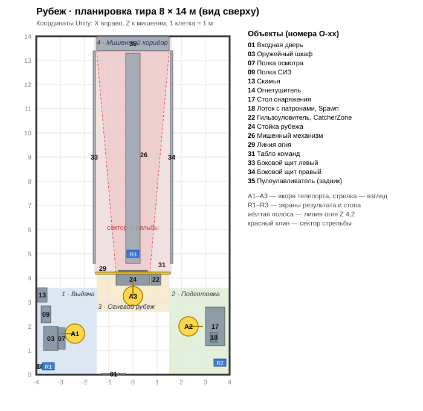

# Планировка тира

Схема: [`layout.svg`](layout.svg) (вид сверху). Координаты из этого файла — источник истины
для блок-моделей (`YG-06`), блокинга `Main.unity` (`NG-04`) и всех сокетов и экранов.
Таблица §3 и схема генерируются из одного списка, при правке меняются вместе.

## 1. Система координат и комната

- Координаты Unity, метры: **X** вправо (если стоять у входа лицом в комнату), **Y** вверх,
  **Z** вглубь, к мишеням. Начало — пол у середины входной стены.
- Комната 8 × 14 м: X от −4 до 4, Z от 0 до 14, высота 3 м. Стены толщиной 0,1 м стоят снаружи
  этого объёма, пол — ниже Y 0.
- Для объектов указан центр габарита. Размер — по осям X × Y × Z в мире (у повёрнутых
  моделей — после поворота).
- Модели в Blender лицевой стороной к −Y: в Unity они смотрят в +Z (`docs/art-pipeline.md`).

## 2. Зоны и порядок пути

Зоны идут в порядке шагов, пользователь не возвращается назад без причины: от входа налево
за оружием и СИЗ, направо снарядить магазин, вперёд на рубеж, и в конце — обратно к шкафу,
потому что путь кончается сдачей оружия.

| Зона | Границы X | Границы Z | Якорь | Шаги ([`user-flow.md`](user-flow.md) §4) |
|---|---|---|---|---|
| 1 · Выдача | −4 … −1,5 | 0 … 3,6 | A1 | 1 получение, 2 осмотр, 3 СИЗ, 9 сдача |
| 2 · Подготовка | 1,5 … 4 | 0 … 3,6 | A2 | 4 снаряжение магазина |
| 3 · Огневой рубеж | −1,5 … 1,5 | 2,6 … 4,2 | A3 | 5 выход на рубеж, 6 стрельба, 7 задержка, 8 разряжание |
| 4 · Мишенный коридор | −1,6 … 1,6 | 4,2 … 14 | — | пользователь не заходит |

Проходы между зонами не уже 1 м: между мебелью зоны 1 (X ≤ −2,8) и зоны 2 (X ≥ 3,0) свободно
5,8 м, от стойки рубежа до мебели зон 1 и 2 — больше 1,5 м.

## 3. Объекты

Номера O-xx используют Issues. Зона «—» — конструкция комнаты.

| ID | Объект | Зона | X | Y | Z | Размер X × Y × Z, м | Примечание |
|---|---|---|---|---|---|---|---|
| O-01 | Входная дверь | — | −0,8 | 1,05 | 0,03 | 1 × 2,1 × 0,06 | статичная, закрыта |
| O-02 | Якорь A1 «Выдача» | 1 | −2,4 | 0 | 1,7 | 0,8 × 0,01 × 0,8 | взгляд −X, к шкафу; старт упражнения |
| O-03 | Оружейный шкаф | 1 | −3,4 | 0,95 | 1,5 | 0,6 × 1,9 × 1 | фасад к +X; надпись «Сдача оружия» вверху фасада |
| O-04 | Дверца шкафа `Door` | 1 | −3,1 | 1,35 | 1,5 | 0,02 × 1,1 × 0,9 | петли по краю Z 1,05; на старте открыта |
| O-05 | Гнездо пистолета `WeaponSlot` | 1 | −3,35 | 1,3 | 1,5 | 0,3 × 0,2 × 0,25 | внутри шкафа, ствол к +Z; старт и финиш пистолета |
| O-06 | Метка финиша | 1 | −3,35 | 1,21 | 1,5 | 0,3 × 0,01 × 0,2 | статичный контур пистолета в O-05, без пульсации |
| O-07 | Полка осмотра | 1 | −2,95 | 1 | 1,5 | 0,3 × 0,04 × 0,9 | откидная столешница шкафа, верх 1,0 м |
| O-08 | Места осмотра на O-07 | 1 | −2,95 | 1,02 | 1,5 | 0,25 × 0,01 × 0,8 | 2 контура: пистолет Z 1,3, магазин Z 1,75 |
| O-09 | Полка СИЗ | 1 | −3,6 | 1,2 | 2,5 | 0,4 × 0,04 × 0,7 | на левой стене рядом со шкафом |
| O-10 | Наушники на `Slot_Earmuffs` | 1 | −3,6 | 1,3 | 2,32 | 0,2 × 0,2 × 0,2 | сокет возврата |
| O-11 | Табличка «СИЗ обязательны» | 1 | −3,98 | 1,75 | 2,5 | 0,02 × 0,25 × 0,5 | над полкой O-09 |
| O-12 | Очки на `Slot_Glasses` | 1 | −3,6 | 1,26 | 2,7 | 0,16 × 0,06 × 0,16 | сокет возврата |
| O-13 | Скамья | 1 | −3,75 | 0,23 | 3,3 | 0,4 × 0,45 × 0,6 | декор, не интерактивна |
| O-14 | Огнетушитель | 1 | −3,85 | 0,3 | 0,35 | 0,18 × 0,6 × 0,18 | декор у входа |
| O-15 | Табличка Т-1, 4 правила | 1 | −3,98 | 1,65 | 0,5 | 0,02 × 0,5 × 0,4 | на стене у шкафа, читается с A1; Z 0,5, а не 0,95: при 0,95 табличку закрывает открытая дверца O-04 (`YG-11`) |
| O-16 | Якорь A2 «Подготовка» | 2 | 2,3 | 0 | 2 | 0,8 × 0,01 × 0,8 | взгляд +X, к столу |
| O-17 | Стол снаряжения | 2 | 3,4 | 0,45 | 2 | 0,8 × 0,9 × 1,6 | верх 0,9 м |
| O-18 | Лоток с патронами, `Spawn` | 2 | 3,35 | 0,93 | 1,55 | 0,3 × 0,06 × 0,4 | выдаёт патроны по одному |
| O-19 | Место магазина на столе | 2 | 3,3 | 0,91 | 2,15 | 0,12 × 0,01 × 0,2 | контур |
| O-20 | Место пистолета на столе | 2 | 3,3 | 0,91 | 2,55 | 0,25 × 0,01 × 0,3 | контур, ствол к +X (к стене) |
| O-21 | Полочка поднятых гильз | 3 | 0,6 | 1,02 | 3,78 | 0,15 × 0,02 × 0,1 | сюда появляется гильза, упавшая на пол |
| O-22 | Гильзоуловитель, `CatcherZone` | 3 | 0,95 | 0,4 | 3,95 | 0,4 × 0,8 × 0,5 | справа от стойки; гильза летит сюда импульсом |
| O-23 | Якорь A3 «Рубеж» | 3 | 0 | 0 | 3,25 | 0,8 × 0,01 × 0,8 | взгляд +Z, к мишеням |
| O-24 | Стойка рубежа | 3 | 0 | 0,5 | 3,95 | 1,4 × 1 × 0,5 | верх 1,0 м, передний край на линии огня Z 4,2 |
| O-25 | Пульт подачи мишени | 3 | −0,5 | 1,03 | 3,9 | 0,2 × 0,06 × 0,15 | `Button`, `Dial`; дистанции 3–9 м |
| O-26 | Мишенный механизм | 4 | 0 | 1,9 | 8,95 | 0,6 × 1,9 × 8,7 | `Rail` Y 2,8 от Z 4,6 до Z 13,3; `TargetPlane` Y 1,5 |
| O-27 | Место пистолета на стойке | 3 | 0,2 | 1 | 3,95 | 0,25 × 0,01 × 0,3 | контур, ствол к +Z |
| O-28 | Место магазина на стойке | 3 | 0,45 | 1 | 3,95 | 0,12 × 0,01 × 0,2 | контур |
| O-29 | Линия огня | 3 | 0 | 0,01 | 4,2 | 3,1 × 0,01 × 0,1 | жёлтая разметка на полу между щитами |
| O-30 | Табличка Т-2, 4 правила | 3 | −0,55 | 1,15 | 4,17 | 0,3 × 0,2 × 0,02 | на дальнем краю стойки, к стрелку |
| O-31 | Табло команд | 3 | 0 | 2,3 | 4,3 | 1,2 × 0,5 × 0,04 | над входом в коридор, к −Z; текст фазы |
| O-32 | Барьер рубежа | 3 | 0 | 0,5 | 4,45 | 3,1 × 1 × 0,05 | сетка-ограждение за стойкой, за линию огня не заходим |
| O-33 | Боковой щит левый | 4 | −1,6 | 1,5 | 9 | 0,1 × 3 × 8,8 | Z 4,6–13,4 |
| O-34 | Боковой щит правый | 4 | 1,6 | 1,5 | 9 | 0,1 × 3 × 8,8 | Z 4,6–13,4 |
| O-35 | Пулеулавливатель (задник) | 4 | 0 | 1,5 | 13,7 | 3 × 3 × 0,6 | лицевая плоскость Z 13,4 |
| O-36 | Светильники коридора | 4 | 0 | 2,95 | 9 | 0,2 × 0,05 × 8 | линия над коридором |
| O-37 | Потолочные козырьки | 4 | 0 | 2,85 | 7 | 3,1 × 0,3 × 0,1 | три козырька Z 7, 9,5, 12 |
| O-38 | Пол | — | 0 | −0,05 | 7 | 8 × 0,1 × 14 | бетон |
| O-39 | Стены | — | 0 | 1,5 | 7 | 8 × 3 × 14 | высота 3 м, толщина 0,1 м снаружи комнаты |
| O-40 | Потолок | — | 0 | 3,05 | 7 | 8 × 0,1 × 14 |  |
| O-41 | Светильники зала | — | 0 | 2,95 | 2 | 6 × 0,05 × 2,5 | над зонами 1–3 |
| O-42 | Вентиляционные решётки | — | 0 | 2,7 | 0,03 | 1 × 0,3 × 0,02 | декор на стене входа |
| O-43 | Шкала прогресса | 3 | 0 | 2,09 | 4,28 | 1,1 × 0,08 × 0,01 | внизу табло O-31, 9 сегментов |

Иерархии и пустышки моделей — §5.2 общего ТЗ и Issues моделей (`MM-05`, `MM-06`, `MM-10`,
`YG-06`, `YG-10`). Пустышки окружения: `WeaponSlot` (O-05), `CatcherZone` (O-22),
`Slot_Earmuffs` (O-10), `Slot_Glasses` (O-12), `Spawn` (O-18).

Высоты столешниц: полка осмотра и стойка рубежа 1,0 м (стрельба стоя), стол снаряжения 0,9 м.
Окончательная высота подгоняется после проверки в шлеме.

## 4. Якоря и экраны

| Якорь | Позиция X, Z | Взгляд | Что видно с якоря |
|---|---|---|---|
| A1 «Выдача» | −2,4; 1,7 | −X (к шкафу) | шкаф O-03, полка осмотра O-07, полка СИЗ O-09, табличка Т-1 O-15, экран R1 |
| A2 «Подготовка» | 2,3; 2,0 | +X (к столу) | стол O-17, лоток O-18, экран R2 |
| A3 «Рубеж» | 0,0; 3,25 | +Z (к мишеням) | стойка O-24, пульт O-25, табло O-31, мишень O-26, экран R3 |

Якоря — `TeleportationAnchor` с `teleportAnchorTransform`, повёрнутым по взгляду. Старт
упражнения на A1.

Экраны — World Space Canvas на уровне глаз (центр Y 1,55), 1,5–2 м от якоря, повёрнуты к
якорю. Во время упражнения скрыты.

| Экран | Позиция X, Y, Z | Расстояние до якоря | Что показывает |
|---|---|---|---|
| R1 | −3,35; 1,55; 3,4 | 1,95 м от A1 | экран результата (всегда), стоп-экран, если пользователь у A1 |
| R2 | 3,6; 1,55; 0,5 | 2,0 м от A2 | стоп-экран, если пользователь у A2 |
| R3 | 0,0; 1,55; 5,0 | 1,75 м от A3 | стоп-экран, если пользователь у A3 |

Экран результата всегда у шкафа (R1): путь кончается сдачей оружия. Стоп-экран грубого
нарушения (FR-39) появляется у того якоря, где стоит пользователь, а через N с из
`RulesConfig` на нём же показывается результат с баллом 0. R3 стоит в коридоре, но включается
только после остановки упражнения, когда стрельба уже невозможна.

## 5. Сектор стрельбы

Сектор — клин мишенного коридора, куда ствол может смотреть без нарушения (FR-30): от линии
огня Z 4,2 до лицевой плоскости пулеулавливателя Z 13,4 между боковыми щитами.

Как считает `SectorDetector` (`VP-05`): раз в кадр один луч из пустышки `Muzzle` вдоль её +Z.
Ствол **в секторе**, если первым луч встречает поверхность сектора или мишень; **вне сектора** —
если первым попались щит, потолок, стена, пол зала или ничего. Клин получается сам собой: это
все направления, по которым пуля из текущего положения ствола уйдёт в пулеулавливатель или в пол
коридора.

| Объект | Слой | Коллайдер | Где |
|---|---|---|---|
| `Sector_TrapFace` | `Sector` | триггер 3,0 × 2,8 × 0,02 м | перед лицом пулеулавливателя, центр (0; 1,5; 13,39) |
| `Sector_CorridorFloor` | `Sector` | триггер 3,1 × 0,02 × 9,2 м | пол коридора от линии огня до ловушки, центр (0; 0,01; 8,8) |
| `TargetPlane` | `Target` | обычный | мишень на каретке |
| щиты O-33, O-34, пулеулавливатель O-35, пол, потолок, стены, стойка | `Environment` | обычные | §3 |

Ствол в пол коридора за линией огня — в секторе (так держат оружие при заряжании и
задержке), в пол зала до линии огня — вне сектора. Сектор считается, только пока пистолет в
руке; занос до 1,5 с — штраф, дольше при снаряжённом оружии — грубое нарушение
(`RulesConfig.sectorGraceSeconds`); выход короче 0,1 с — дрожание руки, не нарушение
(`sectorJitterSeconds`).

## 6. Дистанции мишени

Регулятор пульта O-25 выбирает дистанцию от линии огня до плоскости мишени: **3, 5, 7 или 9 м**
(FR-16). Больше 9 м в комнате не помещается: плоскость мишени на 9 м стоит на Z 13,2, в 0,2 м
перед пулеулавливателем.

| Дистанция | Z плоскости мишени | Где каретка в начале упражнения |
|---|---|---|
| 3 м | 7,2 | |
| 5 м | 9,2 | |
| 7 м | 11,2 | по умолчанию |
| 9 м | 13,2 | дальняя, мишень `MM-12` должна читаться отсюда |

Каретка стоит у ближнего края направляющей (Z 4,8), рамка мишени развёрнута ребром.
По кнопке каретка едет на выбранную дистанцию и рамка разворачивается к стрелку.
Плоскость мишени `TargetPlane` 0,5 × 0,5 м, центр Y 1,5.

## 7. Слои

| Слой | Назначение |
|---|---|
| Interaction Layer 31 `Teleport` | якоря телепорта |
| Interaction Layer 1 `Pistol` | пистолет: принимают O-05, O-08, O-20, O-27 |
| Interaction Layer 2 `Magazine` | магазин: принимают шахта `MagWell`, O-08, O-19, O-28 |
| Interaction Layer 3 `Round` | патрон: принимают `Round_01`…`Round_05` магазина |
| Interaction Layer 4 `Earmuffs`, 5 `Glasses` | СИЗ: слоты у головы и O-10, O-12 |
| Near-Far Interactor рук | видит слои 0–5 (Default и предметы), телепорт — только 31 |
| Physics Layer `Sector` | объём сектора §5, только для лучей детектора |
| Physics Layer `Target` | плоскость мишени, только для луча выстрела |

## 8. Тексты табличек (`YG-11`)

Тон нейтрально-технический, текст графитом `#1D2228` по белому полю, рамка — сигнальный жёлтый.

- **Т-1 (O-15)**: «Правила безопасности. 1. Оружие всегда считается заряженным. 2. Ствол — только в
  сторону мишеней. 3. Палец на спуске — только по команде «Огонь». 4. В ствол не заглядывать».
- **Т-2 (O-30)**, короче — читается со стойки: «1. Оружие считать заряженным. 2. Ствол — к мишеням.
  3. Палец на спуске — по «Огонь». 4. В ствол не смотреть».
- **O-11** над полкой СИЗ: «СИЗ обязательны. Наушники и очки — до выхода на рубеж».
- **Метка финиша**: надпись «Сдача оружия» на фасаде шкафа O-03 и статичный контур O-06 в гнезде
  O-05 — зелёные `#3E9E4F`, без пульсации (пульсация — только у подсказки FR-26).

Правила совпадают с тем, что ловят детекторы: заряженность (`MuzzleOutOfSector` при снаряжённом
оружии), сектор, палец на спуске, взгляд в ствол.
