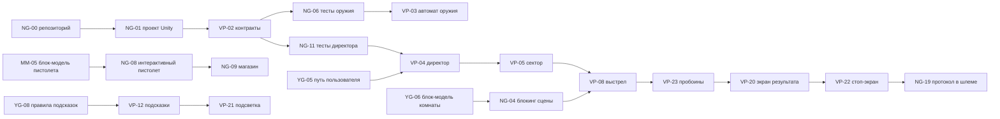

# MVP, приоритеты и критический путь

## 1. Цель

Рубеж учит безопасному обращению с пистолетом в тире: пользователь проходит полный цикл
упражнения руками, а система ловит нарушения, которые в жизни стоят травмы.
Главное — не меткость, а **состояние постоянного контроля**: куда смотрит ствол, где палец,
заряжено ли оружие.

**MVP** — один полный цикл из девяти шагов в одной комнате (8 × 14 м), с фоновым контролем
безопасности, остановкой на грубом нарушении и экраном результата с «Повторить».
Цикл занимает до 6 минут.

## 2. Что входит в MVP и что нет

| Входит | Не входит |
|---|---|
| 9 шагов: получение, осмотр, СИЗ, снаряжение, рубеж, стрельба, задержка, разряжание, сдача | другие упражнения, другие виды оружия |
| Телепорт по трём якорям и snap turn | плавное перемещение |
| Детекторы: сектор ствола, палец на спуске, взгляд в ствол | детектор наведения на людей: людей в сцене нет |
| Осечка на 3–4 выстреле и её устранение | прихват гильзы (SHOULD, `VP-13`) |
| Табло команд у рубежа | голос инструктора (SHOULD, `VP-14`) |
| Подсказки по бездействию 5 с: подсветка объекта и фраза у контроллера | повтор эпизода нарушения (COULD, `VP-17`) |
| Стоп-экран грубого нарушения, экран результата, «Повторить» | таблица рекордов, профили пользователей |
| Наушники глушат выстрел, очки дают оправу | оттенок стёкол (COULD, `NG-30`) |
| Финальные модели, запечённый свет, 72 Гц на Quest 2 | MR, passthrough |

## 3. Реестр требований

Приоритет по MoSCoW: MUST — без этого MVP нет, SHOULD — делаем, если укладываемся,
COULD — при запасе времени. На эти номера ссылаются Issues.

### Перемещение и ввод

| ID | Требование | Приоритет | Задачи |
|---|---|---|---|
| FR-01 | Сцена открывается в зоне выдачи, пользователь стоит у якоря A1 лицом к шкафу | MUST | `NG-03` |
| FR-02 | Перемещение только телепортом по трём якорям A1–A3; плавного хода нет | MUST | `NG-03`, `YG-16` |
| FR-03 | Поворот щелчками (snap turn), разворот на 180° стиком назад | MUST | `NG-03`, `YG-16` |
| FR-04 | Касание пальцем спускового крючка отличается от нажатия (ёмкостный датчик или запасной порог) | MUST | `NG-05`, `VP-06` |
| FR-05 | Всё управление работает и левой рукой, фразы подставляют кнопки руки (A/B или X/Y) | MUST | `NG-08`, `NG-32` |

### Оружие и боеприпасы

| ID | Требование | Приоритет | Задачи |
|---|---|---|---|
| FR-06 | Пистолет берётся одной или двумя руками | MUST | `NG-08` |
| FR-07 | Затвор отводится рукой, становится на задержку и снимается с неё | MUST | `NG-08`, `VP-03` |
| FR-08 | Предохранитель включается и снимается кнопкой B/Y | MUST | `NG-08`, `VP-03` |
| FR-09 | Магазин выпадает по кнопке A/X и вставляется рукой в шахту | MUST | `NG-08`, `NG-09` |
| FR-10 | Магазин снаряжается 5 патронами по одному из лотка | MUST | `NG-09` |
| FR-11 | Стрельба только при досланном патроне и снятом предохранителе; без патрона — сухой щелчок | MUST | `VP-03` |
| FR-12 | Гильза вылетает из окна выброса при каждом выстреле и падает в гильзоуловитель или на пол | MUST | `VP-19` |
| FR-13 | Уроненный предмет возвращается на своё место без штрафа | MUST | `NG-09`, `NG-10` |

### СИЗ, мишень, отклик

| ID | Требование | Приоритет | Задачи |
|---|---|---|---|
| FR-14 | Наушники приглушают выстрел, очки дают оправу в поле зрения | MUST | `NG-10`, `MM-11` |
| FR-15 | Пульт подачи мишени: кнопка и регулятор дистанции | MUST | `NG-12` |
| FR-16 | Мишень едет на выбранную дистанцию 3–9 м и разворачивается к стрелку | MUST | `NG-12`, `MM-10` |
| FR-17 | Пробоины видны на мишени с рубежа | MUST | `VP-23` |
| FR-18 | Звук на каждое действие с оружием: затвор, магазин, предохранитель, патрон, гильза | MUST | `MM-09` |
| FR-19 | Объект подсвечивается при наведении руки | MUST | `NG-15` |
| FR-20 | Подсказка цветом и формой отличается от контуров мест и метки финиша | MUST | `VP-21`, `YG-11` |
| FR-21 | Отдача вибрацией при каждом выстреле, щелчок вибрацией на магазин; на осечке отдачи нет | MUST | `NG-15` |

### Задержки и инструктор

| ID | Требование | Приоритет | Задачи |
|---|---|---|---|
| FR-22 | Осечка на 3-м или 4-м выстреле; правильное устранение — выждать 5 с, не уводя ствол, затем перезарядить | MUST | `VP-09`, `NG-23` |
| FR-23 | Прихват гильзы и его устранение | SHOULD | `VP-13`, `NG-29` |
| FR-24 | Команды инструктора по фазам: «Получить оружие», «Осмотр», ..., «Огонь», «Стой» | MUST | `VP-04`, `YG-07` |
| FR-25 | Команды звучат голосом инструктора; запасной вариант — табло команд с сигналом | SHOULD голос / MUST табло | `VP-14`, `VP-24` |
| FR-26 | После 5 с бездействия подсвечивается следующий объект и у контроллера появляется фраза «<кнопка>: <действие>» | MUST | `VP-12`, `VP-21`, `NG-32` |
| FR-27 | О нарушениях заранее не предупреждаем: сначала действие, потом замечание | MUST | `VP-12`, `YG-08` |

### Контроль безопасности

| ID | Требование | Приоритет | Задачи |
|---|---|---|---|
| FR-28 | Контроль идёт параллельно всем шагам, пока пистолет в руке | MUST | `VP-05`, `VP-06` |
| FR-29 | Мелкое нарушение — штраф и короткое замечание у контроллера; упражнение продолжается | MUST | `VP-04`, `NG-32` |
| FR-30 | Ствол вне сектора: занос до 1,5 с — штраф, дольше при снаряжённом оружии — грубое нарушение | MUST | `VP-05` |
| FR-31 | Палец на спуске вне фазы «Огонь» — нарушение | MUST | `VP-06` |
| FR-32 | Взгляд в ствол — грубое нарушение | MUST | `VP-07` |
| FR-33 | Выход на рубеж без наушников или очков — нарушение | MUST | `VP-11` |
| FR-34 | Нарушение порядка шагов — нарушение `StepOrder` | MUST | `VP-04` |
| FR-35 | Выстрел до команды «Огонь» и после «Стой» — грубое нарушение | MUST | `VP-08` |
| FR-36 | Выстрел вне сектора — грубое нарушение | MUST | `VP-08` |
| FR-37 | Шкаф не принимает заряженный пистолет; попытка сдачи — штраф один раз на подход | MUST | `NG-14`, `VP-11` |
| FR-38 | Гильзы вне гильзоуловителя при сдаче — штраф | MUST | `VP-11`, `VP-19` |
| FR-39 | Грубое нарушение останавливает упражнение: стоп-экран с причиной у текущего якоря | MUST | `VP-22` |

### Результат

| ID | Требование | Приоритет | Задачи |
|---|---|---|---|
| FR-40 | Балл: 100 минус штрафы за нарушения, промахи и превышение 6 минут, не ниже 0; при грубом нарушении 0 | MUST | `VP-10`, `NG-24` |
| FR-41 | Вердикт: ≥ 80 — зачёт, 60–79 — зачёт с замечаниями, < 60 или грубое — не зачёт | MUST | `VP-10`, `NG-24` |
| FR-42 | Экран результата: вердикт, балл, время, точность, мишень с пробоинами, нарушения, «Повторить» | MUST | `VP-20`, `YG-09` |
| FR-43 | У каждого нарушения на экране результата видно время | SHOULD | `VP-15` |
| FR-44 | «Повторить» начинает упражнение сначала без перезапуска приложения | MUST | `VP-20` |
| FR-45 | Повтор эпизода нарушения | COULD | `VP-17` |

Веса штрафов и все пороги (1,5 с, 5 с, 6 минут, порог касания) лежат в `RulesConfig`
(`Assets/_Rubezh/Data/Rules/`), не в коде.

## 4. Девять объектов MVP

Пистолет, магазин, патрон и лоток, наушники, очки, пульт подачи мишени, мишенный механизм,
гильзоуловитель, оружейный шкаф. Карточки поведения — [`objects.md`](objects.md),
места в комнате — [`layout.md`](layout.md) §3.

## 5. Заглушки

Чтобы цикл собирался раньше финальной графики, каждая зависимость имеет заглушку.

| Чего ждём | Заглушка до готовности | Кто подменяет, когда |
|---|---|---|
| Блок-модели комнаты и мебели | примитивы в `Main.unity` по [`layout.md`](layout.md) | Юля, `YG-06`, M2 |
| Модель мишени | плоскость `TargetPlane` 0,5 × 0,5 м | Маша, `MM-10`, M4 |
| Блок-модель пистолета | примитивы с пустышками по §5.2 ТЗ | Маша, `MM-05`, M2 |
| Финальные модели | блок-модели | Маша и Юля, M3–M4 |
| Реальный ввод касания | заглушка `ITriggerInput` у Влада | Никита, `NG-05` |
| Ёмкостный датчик на шлеме | `IsTouched = PressValue > порог` из `RulesConfig` | — |
| Голос инструктора | табло команд у рубежа | Юля и Влад, `YG-13`, `VP-14` |
| Звуки оружия | временный звук выстрела | Маша, `MM-09`, M3 |

## 6. Зависимости

Подробные строки «Ждёт» и «Нужна для» стоят в каждом issue. Крупные связи:

## 7. Приоритеты

| Метка | Смысл |
|---|---|
| `P0` | критический путь MVP, блокирует другие задачи |
| `P1` | MUST, входит в MVP, но не блокирует |
| `P2` | SHOULD, делаем, если укладываемся |
| `P3` | COULD, при запасе времени |

В каждом issue под вехой строка приоритета: метка, входит ли в MVP и почему.

## 8. Критический путь

**NG-00 → NG-01 → VP-02 → NG-11 → VP-04 → VP-05 → VP-08 → VP-23 → VP-20 → VP-22 → NG-19**

Задержка любой задачи на этом пути сдвигает MVP. Параллельно пути идут модели (через
блокинг `NG-04` и пистолет `NG-08`) и подсказки (`YG-08` → `VP-12` → `VP-21`).

### 8.1 MVP для тестирования

MVP готов к плейтесту, когда:

1. Цикл из 9 шагов проходится в шлеме от A1 до сдачи оружия в шкаф.
2. Каждое нарушение из `Violation` вызывается нарочно и ловится (протокол `NG-19`).
3. Грубое нарушение показывает стоп-экран, после него — экран результата и «Повторить».
4. Стабильные 72 Гц на рубеже при стрельбе.

Плейтест с двумя другими командами — веха M7 (`NG-22`), формы обратной связи заполняют все.
