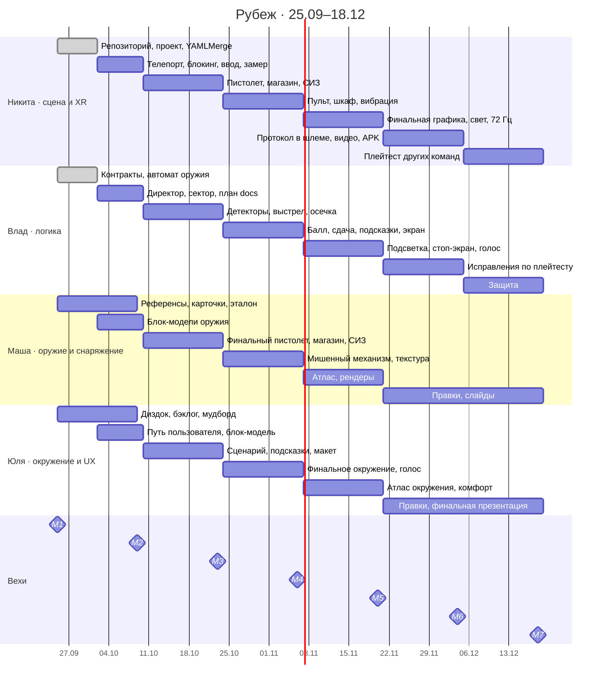

# Дорожная карта

## 1. Занятия курса

Занятия раз в две недели; каждое занятие — веха (M1–M7 в Issues) и показ того, что готово.

| Дата | Веха | Тема занятия ([`course-topics.md`](course-topics.md)) | Что показываем |
|---|---|---|---|
| 11.09 | — | старт курса, VR-пакет | идея, команда, роли |
| 25.09 | M1 | VR-пакет XRI, планирование | репозиторий, проект Unity, бэклог в Issues, дизайн-документ |
| 09.10 | M2 | ввод и жесты | план проекта (`docs/`), демо-срез: телепорт, блокинг, автомат оружия с тестами, замер |
| 23.10 | M3 | взаимодействие и физика | интерактивный пистолет, магазин, СИЗ, детекторы, табло команд |
| 06.11 | M4 | модели сложной формы | финальный пистолет и мишенный механизм в движении, балл и вердикт, экран результата |
| 20.11 | M5 | графика под Quest, эффекты, комфорт | финальная графика, запечённый свет, 72 Гц, подсветка, стоп-экран |
| 04.12 | M6 | постпроцессинг, тестирование | протокол проверки в шлеме, исправления, видео, APK в Releases |
| 18.12 | M7 | защита | финальная презентация, плейтест двух других команд |

## 2. Спринты

Спринт — две недели между занятиями (поле Sprint на досках). В конце спринта `dev`
сливается в `main` (`docs/decisions.md`, Р-02).

| Спринт | Даты | Цель | Ключевые задачи |
|---|---|---|---|
| 1 | 25.09–09.10 | проект, контракты, план, блокинг | `NG-00`–`NG-07`, `NG-11`, `VP-01`–`VP-05`, `VP-25`, `MM-01`–`MM-06`, `YG-01`–`YG-06` |
| 2 | 10.10–23.10 | интерактив и детекторы | `NG-08`–`NG-10`, `NG-21`, `NG-23`, `VP-06`–`VP-09`, `VP-23`, `VP-24`, `MM-07`–`MM-09`, `MM-11`, `YG-07`–`YG-09`, `YG-11` |
| 3 | 24.10–06.11 | замкнуть цикл: сдача, балл, экран | `NG-12`, `NG-14`, `NG-15`, `NG-24`, `VP-10`–`VP-12`, `VP-19`, `VP-20`, `MM-10`, `MM-12`, `MM-17`, `YG-10`, `YG-13` |
| 4 | 07.11–20.11 | финальная графика, подсказки, стоп | `NG-17`, `NG-18`, `NG-29`, `NG-31`, `NG-32`, `VP-13`, `VP-14`, `VP-21`, `VP-22`, `MM-13`, `MM-15`, `YG-12`, `YG-16` |
| 5 | 21.11–04.12 | проверка в шлеме и исправления | `NG-19`, `NG-20`, `NG-30`, `VP-15`–`VP-17`, `MM-14`, `YG-14` |
| 6 | 05.12–18.12 | защита и плейтест | `NG-22`, `VP-18`, `MM-16`, `YG-15` |

## 3. Первый спринт (25.09–09.10)

**Цель:** к 09.10 показать, что проект собран правильно и цикл можно строить дальше.

- **Отбор моделей.** Референсы пистолета, магазина, мишени и СИЗ (`MM-02`), карточки поведения
  девяти объектов (`MM-03`), эталонный куб и настройки экспорта (`MM-04`), блок-модели
  пистолета, магазина и комнаты (`MM-05`, `MM-06`, `YG-06`).
- **Первая архитектура.** Контракты `Rubezh.Core` и `Rubezh.Gameplay` (`VP-02`), автомат оружия
  с табличными тестами (`VP-03`, `NG-06`), директор упражнения с тестами (`VP-04`, `NG-11`),
  детектор сектора (`VP-05`).
- **Сцена.** XR Origin с телепортом по трём якорям (`NG-03`), блокинг по [`layout.md`](layout.md)
  (`NG-04`), ввод касания спуска (`NG-05`), первый замер производительности (`NG-07`).
- **План.** Документы `docs/` по требованиям преподавателя (`VP-25`, [`teacher-requirements.md`](teacher-requirements.md)),
  пользовательский путь (`YG-05`), бэклог (`YG-04`).

**Что показываем 09.10:** этот план, телепорт и блокинг в XR Interaction Simulator, зелёные
тесты оружия и директора, замер производительности блокинга.

## 4. Диаграмма Ганта

## 5. Плейтест

1. **M5–M6, внутренний.** Протокол ручной проверки в шлеме (`NG-19`): строка на каждое
   нарушение и основные сценарии, прогоняет вся команда, баги — Issues с меткой `bug`.
2. **M6, исправления.** `VP-16`, `MM-14`, `YG-14` закрывают баги по своим меткам.
3. **M7, внешний.** Две другие команды проходят Рубеж, мы — их проекты (`NG-22`).
   Формы обратной связи заполняют все, «некомфортные вещи» закрываем до плейтеста (`YG-16`).
