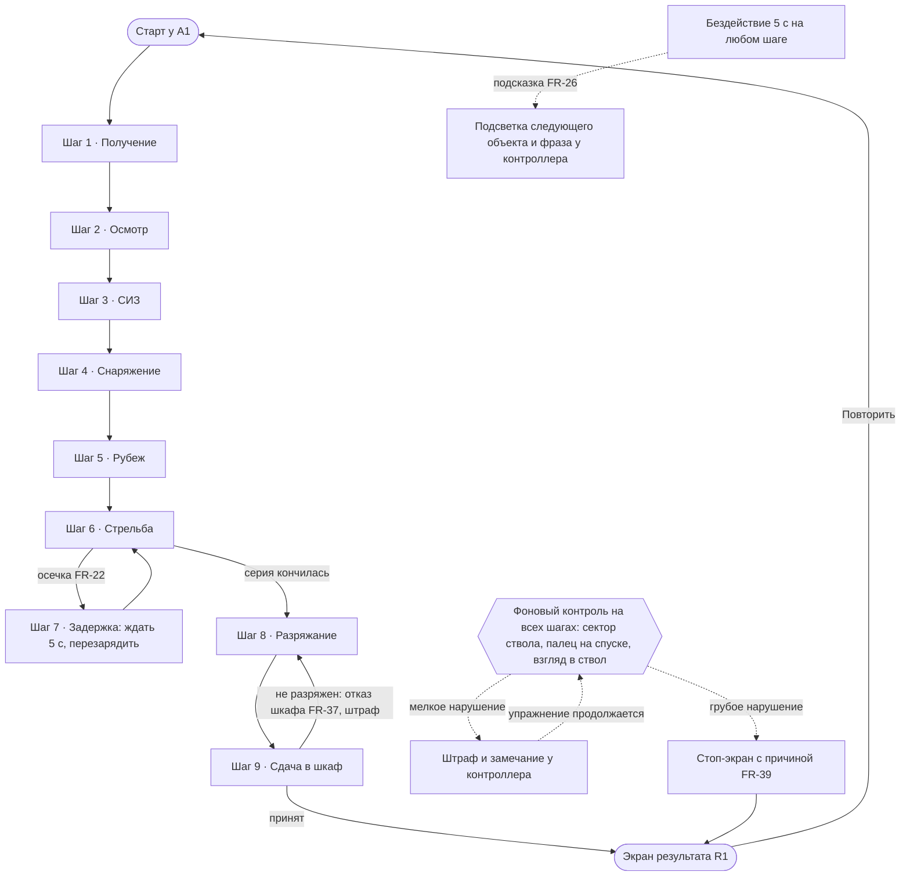

# Путь пользователя

Путь из девяти шагов с законами UX и мотивацией, условия закрытия фаз директора
упражнения, подсказки, ветки ошибок и шкала прогресса. Названия фаз и нарушений совпадают с
`Phase` и `Violation` в `Rubezh.Core`. Места объектов — [`layout.md`](layout.md).

## 1. Пользователь и мотивация

**Кто.** Новичок 18–25 лет, впервые или почти впервые держит оружие, в VR играл, но не
обязательно с контроллерами Quest. Взрослый: навязчивой опеки не терпит, подсказку хочет
только когда застрял.

**Зачем проходит упражнение.**
- Научиться порядку действий, который в реальном тире проверяет инструктор, без риска для себя
  и окружающих.
- Получить навык «постоянного контроля»: где ствол, где палец, заряжено ли оружие.
- Увидеть, как ошибки, которые кажутся мелкими, превращаются в остановку упражнения.

**Что получает.** Балл, вердикт и разбор нарушений со временем: понятно, что именно исправить
во втором заходе. «Повторить» без перезапуска приложения превращает упражнение в короткую
тренировочную петлю (цикл ≤ 6 минут).

**Почему VR.** Касание пальцем спускового крючка отличается от нажатия (ёмкостный датчик
контроллера), направление ствола и взгляд в ствол считываются из положения рук и головы.
Ни экран, ни видео этого не проверят.

## 2. Законы UX, на которые опирается путь

| Закон | Как используем | Шаги |
|---|---|---|
| Закон Якоба | шкаф, стойка, лоток устроены и стоят как в настоящем тире | все |
| Закон Фиттса | крупные сокеты и контуры мест, предметы на расстоянии руки от якоря | 2, 4, 5 |
| Закон Хика | на каждом шаге одно следующее действие, лишние объекты не подсвечиваются | все |
| Закон Миллера | в шаге не больше 3–4 действий, длинные операции разбиты на фазы | 2, 6, 8 |
| Закон общей области | места предмета обведены контуром на столешнице | 2, 4, 5, 8 |
| Закон близости | СИЗ на полке рядом со шкафом, лоток рядом с местом магазина | 3, 4 |
| Видимость состояния системы | затвор на задержке видно, табло показывает команду всю фазу | 2, 6–8 |
| Goal-Gradient | шкала из 9 сегментов (O-43) приближается к концу на глазах | все, §6 |
| Эффект Зейгарник | незакрытый сегмент шкалы тянет закончить цикл | 9 |
| Правило пика и конца | пик — стрельба и пробоины, конец — экран результата с понятным вердиктом | 6, 9 |
| Порог Доэрти | отклик на действие (звук, вибрация) приходит в тот же кадр | все |

## 3. Онбординг

Четыре выноски у контроллера (`NG-32`), по одной, каждая один раз за сессию. После «Повторить»
не показываются: флаг живёт до выхода из приложения. Онбординг учит управлению, о правилах
безопасности он не говорит (о нарушениях заранее не предупреждаем, FR-27).

| № | Когда появляется | Рука | Текст |
|---|---|---|---|
| 1 | старт сцены у A1 | обе | «Стик вперёд: телепорт на жёлтый круг» |
| 2 | первая наводка руки на предмет | наводящая | «Grip: взять предмет» |
| 3 | пистолет впервые в руке | рука на `Grip_Primary` | «A: выпустить магазин · B: предохранитель» (левая: X, Y) |
| 4 | впервые нужна работа затвором (фаза `Inspect`) | свободная | «Grip на затворе: отвести затвор» |

Выноска снимается действием, о котором говорит, или через 8 с.

## 4. Шаги

### 4.0 Общие правила подсказок

- **Подсказка FR-26** появляется после **5 с бездействия** на шаге (`RulesConfig`): подсвечивается
  следующий объект (`VP-21`) и у контроллера фраза `<кнопка>: <действие>` (`NG-32`).
- Таймер бездействия сбрасывают: захват, отпускание, событие сокета, любая `WeaponCommand`,
  `PhaseChanged`, телепорт.
- Кнопка в фразе подставляется по руке: справа A/B, слева X/Y.
- Если нужный объект у другого якоря, подсвечивается метка якоря и фраза «Стик: телепорт к …».
- В `Fire` подсказка активна до первого выстрела. После `DryFire` пауза 5 с (время на правильную
  реакцию на осечку), затем подсказка на затвор. В `Done` и `Failed` подсказок нет.
- Подсказка только по бездействию: о нарушениях заранее не предупреждаем.
- Приоритет сообщений у контроллера: замечание о нарушении > подсказка > онбординг.

### 4.1 Сводная таблица

| Шаг | Фаза `Phase` | Якорь | Команда (табло) | Фаза закрывается, когда | Подсказка FR-26 |
|---|---|---|---|---|---|
| 1. Получение | `Receive` | A1 | «Получите оружие в шкафу» | пистолет в руке, старт таймера | пистолет в O-05: «Grip: взять пистолет» |
| 2. Осмотр | `Inspect` | A1 | «Контрольный осмотр» | магазин отделён, затвор на задержке, патронник `Empty` | кнопка магазина: «A: отделить магазин», затем затвор: «Grip на затворе: отвести затвор» |
| 3. СИЗ | `Ppe` | A1 | «Наденьте наушники и очки» | наушники и очки надеты | наушники O-10: «Grip: взять наушники», очки O-12: «Grip: взять очки» |
| 4. Снаряжение | `LoadMagazine` | A2 | «Снарядите магазин: 5 патронов» | 5 патронов, магазин не в оружии | метка A2, затем лоток O-18: «Grip: взять патрон» |
| 5. Рубеж | `ToLine` | A3 | «На рубеж. Оружие и магазин на стойку» | пистолет на O-27, магазин на O-28, мишень подана | метка A3, места O-27, O-28, затем пульт O-25: «Нажмите: подать мишень» |
| 6. Стрельба | `Load` | A3 | «Заряжай» | магазин в оружии | магазин: «Grip: магазин в шахту» |
| | `Fire` | A3 | «Огонь» | серия кончилась (5 выстрелов или магазин пуст) | затвор: «Grip на затворе: дослать патрон», предохранитель: «B: снять с предохранителя» |
| 7. Задержка | `Fire` (осечка) | A3 | «Огонь» | патрон после осечки извлечён, стрельба продолжена | через 5 с после `DryFire` затвор: «Grip на затворе: перезарядить» |
| 8. Разряжание | `Cease` | A3 | «Стой! Предохранитель» | предохранитель включён | предохранитель: «B: на предохранитель» |
| | `Unload` | A3 | «Разряжай» | магазин снят, патронник пуст, затвор на задержке | кнопка магазина: «A: отделить магазин», затвор: «Grip на затворе: на задержку» |
| | `ShowClear` | A3 | «Оружие к осмотру» | пистолет на O-27 открытым, магазин на O-28 | места O-27, O-28: «Grip: положить на стойку» |
| 9. Сдача | `Return` | A1 | «Сдайте оружие в шкаф» | `WeaponSlot` принял пистолет | метка A1, затем O-05: «Grip: пистолет в шкаф» |
| — | `Done` | A1 | «Упражнение окончено» | — | нет |

Фоновый контроль (сектор ствола, палец на спуске, взгляд в ствол) идёт параллельно всем
шагам, пока пистолет в руке. Порядок шагов строгий: действие следующей фазы раньше времени —
`StepOrder` (например, вставить магазин на шаге 2 или снарядить магазин до СИЗ).

Стартовое состояние: пистолет в O-05 с пустым магазином, патронник `Empty`, затвор впереди,
предохранитель включён, дверца шкафа открыта, СИЗ на полке, мишень у ближнего края без дистанции.

### 4.2 Шаг 1. Получение

Пользователь стоит у A1 лицом к шкафу, табло просит получить оружие. Берёт пистолет из O-05,
таймер стартует. Пистолет берётся уже стволом к мишеням: сектор не нарушен с первой секунды.

- **Закон UX:** закон Якоба — шкаф с оружием как в реальном тире, пистолет на виду.
- **Мотивация:** цель ясна сразу, первое действие простое — уверенный старт.
- **Отклик:** вибрация захвата, звук снятия с подставки.

### 4.3 Шаг 2. Осмотр

Отделить магазин (A/X), положить на полку осмотра O-08, отвести затвор и поставить на
задержку, убедиться, что патронник пуст. Затвор встаёт на задержку сам, если магазин пустой
или его нет. Перейти к СИЗ с неоконченным осмотром — `IncompleteInspection`.

- **Закон UX:** закон Миллера — три действия, каждое видно (магазин в руке, затвор сзади);
  видимость состояния системы.
- **Мотивация:** компетентность — пользователь сам убеждается, что оружие разряжено.
- **Отклик:** звук выпадения магазина, щелчок задержки затвора, вибрация.

### 4.4 Шаг 3. СИЗ

Взять наушники и очки с полки O-09 и поднести к голове: слоты у головы принимают их.
Наушники сразу приглушают звук зала, очки дают оправу в поле зрения.

- **Закон UX:** закон близости — СИЗ на полке рядом со шкафом; немедленная обратная связь.
- **Мотивация:** забота о себе, ощущение «я готов к стрельбе».
- **Отклик:** звук глуше (снапшот микшера «Наушники»), оправа очков.

### 4.5 Шаг 4. Снаряжение магазина

Телепорт к A2, магазин на место O-19, патроны из лотка O-18 по одному в магазин, пять раз.

- **Закон UX:** закон Фиттса — лоток рядом с местом магазина, сокеты патронов крупные;
  закон общей области — контур под магазин.
- **Мотивация:** ритм простого повторяющегося действия, счётчик 5 из 5 на магазине.
- **Отклик:** щелчок и вибрация на каждый патрон.

### 4.6 Шаг 5. Выход на рубеж

Телепорт к A3, пистолет на O-27 стволом к мишеням, магазин на O-28, подать мишень кнопкой
пульта O-25 на выбранную регулятором дистанцию. Выход на рубеж без наушников или очков —
`NoEarmuffs`, `NoGlasses`.

- **Закон UX:** закон общей области — контуры мест на стойке; разметка линии огня O-29.
- **Мотивация:** ожидание — сейчас начнётся стрельба.
- **Отклик:** мишень едет и разворачивается, звук каретки.

### 4.7 Шаг 6. Стрельба

По команде «Заряжай» вставить магазин и дослать патрон затвором. По команде «Огонь» снять с
предохранителя и стрелять. Выстрел до «Огонь» — `ShotBeforeFire`, вне сектора —
`ShotOutOfSector` (грубые).

- **Закон UX:** правило пика и конца — пик впечатления; видимость состояния — пробоины на мишени.
- **Мотивация:** мастерство, видимый результат каждого выстрела.
- **Отклик:** звук выстрела (в наушниках глуше), отдача вибрацией, пробоина, гильза летит в
  гильзоуловитель.

### 4.8 Шаг 7. Задержка

На 3-м или 4-м выстреле осечка: сухой щелчок, отдачи нет. Правильно: выждать 5 с, не уводя
ствол из сектора, затем отвести затвор (патрон выброшен) и продолжить стрельбу.
Перезарядка раньше 5 с — `JamMishandled`. Заглянуть в ствол — `LookIntoMuzzle` (грубое).

Прихват гильзы (SHOULD FR-23, `VP-13`): примерно в каждом втором упражнении на одном из выстрелов
2–5 гильза застревает в окне выброса — выстрел был, следующего нет. Правильно: сразу отвести затвор
(гильза вылетает) и продолжить, ствол к мишеням, в ствол не заглядывать. Снова жать на спуск при
прихвате — `JamMishandled`.

- **Закон UX:** видимость состояния системы — сухой щелчок и отсутствие отдачи ясно говорят,
  что выстрела не было.
- **Мотивация:** реальная нештатная ситуация, которую нельзя отработать на экране.
- **Отклик:** сухой щелчок, без вибрации; после перезарядки — звук выброса патрона.

### 4.9 Шаг 8. Разряжание и шаг 9. Сдача

По «Стой» — предохранитель. Выстрел после «Стой» — `ShotAfterCease` (грубое). По «Разряжай»
отделить магазин, отвести затвор на задержку, патронник пуст. По «Оружие к осмотру» положить
открытый пистолет на O-27, магазин на O-28. Затем взять пистолет, телепорт к A1 и поставить в
шкаф O-05. Шкаф не примет заряженный пистолет (FR-37): штраф `ReturnedLoaded` один раз на
подход, вибрация и замечание. Гильзы вне гильзоуловителя к моменту сдачи — `CasingLeft`.
Снятие СИЗ в конце цикла не проверяется.

- **Закон UX:** эффект Зейгарник и Goal-Gradient — последний сегмент шкалы; правило конца —
  экран результата сразу после сдачи.
- **Мотивация:** закрыть цикл и увидеть оценку.
- **Отклик:** щелчок фиксатора шкафа, экран результата на R1.

## 5. Схема с ветками

Ошибки двух классов: **ошибки управления** (уронил предмет, не тот сокет, промахнулся
телепортом) прощаются без штрафа — предмет возвращается на место; **нарушения безопасности**
дают штраф или останавливают упражнение.

Экспорт схемы картинкой: [`user-flow.png`](user-flow.png).

## 6. Шкала прогресса O-43

Девять сегментов внизу табло O-31: **Получение, Осмотр, СИЗ, Снаряжение, Рубеж, Стрельба,
Задержка, Разряжание, Сдача**. Сегмент загорается, когда шаг закрыт; логики фаз в UI нет,
шкала слушает события директора (`NG-31`).

| Сегмент | Загорается |
|---|---|
| 1 Получение | `Receive` → `Inspect` |
| 2 Осмотр | `Inspect` → `Ppe` |
| 3 СИЗ | `Ppe` → `LoadMagazine` |
| 4 Снаряжение | `LoadMagazine` → `ToLine` |
| 5 Рубеж | `ToLine` → `Load` |
| 6 Стрельба | событие `Jammed`; без осечки — на `Fire` → `Cease` |
| 7 Задержка | после устранения осечки; без осечки — на `Fire` → `Cease` |
| 8 Разряжание | `ShowClear` → `Return` |
| 9 Сдача | `Return` → `Done` |

На `Failed` шкала замирает, на `Restart` обнуляется.

## 7. Нарушения

| `Violation` | Класс | Когда считается | Реакция |
|---|---|---|---|
| `MuzzleOutOfSector` | мелкое / грубое | пистолет в руке, ствол вне сектора: до 1,5 с — штраф, дольше при снаряжённом оружии — грубое. Вне рубежа (у шкафа и стола) безопасно и «вниз» (ствол ниже горизонта на 30°+), а занос короче 1,5 с при повороте прощается (#164) | замечание / стоп |
| `FingerOnTrigger` | мелкое | палец касается спуска вне `Fire`, рука на `Grip_Primary` | замечание, длительность в записи |
| `LookIntoMuzzle` | грубое | камера шлема перед дульным срезом | стоп |
| `NoEarmuffs` | мелкое | `ToLine` закрыта без наушников | замечание |
| `NoGlasses` | мелкое | `ToLine` закрыта без очков | замечание |
| `StepOrder` | мелкое | действие другой фазы раньше времени | замечание |
| `IncompleteInspection` | мелкое | уход с осмотра до его завершения | замечание |
| `ShotBeforeFire` | грубое | выстрел до команды «Огонь» | стоп |
| `ShotAfterCease` | грубое | выстрел после «Стой» | стоп |
| `ShotOutOfSector` | грубое | выстрел, когда ствол вне сектора | стоп |
| `ReturnedLoaded` | мелкое | попытка сдать неразряженный пистолет, один раз на подход | отказ шкафа, замечание |
| `CasingLeft` | мелкое | при сдаче гильзы вне гильзоуловителя | замечание |
| `JamMishandled` | мелкое | перезарядка после осечки раньше 5 с | замечание |

Короткие нейтральные названия нарушений для замечаний и экрана результата лежат в
`Data/Hints` (`YG-08`). Тон нейтрально-технический: «ствол вне сектора», а не «вы опять нарушили».

## 8. Время

Лимит цикла 6 минут (`RulesConfig`). Таймер стартует, когда пистолет взят из шкафа, и
останавливается при `Done` или `Failed`. Превышение лимита — штраф в балле (FR-40), упражнение
не прерывается.

### Балл и вердикт (FR-40, FR-41, `VP-10`)

Балл = 100 − штрафы мелких нарушений − 3 за каждый промах − штраф за время, не ниже 0. Время: за
каждые начатые 10 с сверх 6 минут −2, но не больше −20. Грубое нарушение — 0 баллов и «не зачёт».
Вердикт: от 80 — зачёт, 60–79 — зачёт с замечаниями, ниже 60 — не зачёт. Все числа — в `RulesConfig`.

| Нарушение | Штраф |
|---|---|
| `MuzzleOutOfSector` (мелкое), `FingerOnTrigger`, `IncompleteInspection`, `JamMishandled` | 10 |
| `NoEarmuffs`, `NoGlasses`, `ReturnedLoaded` | 15 |
| `StepOrder`, `CasingLeft` | 5 |

Пример: два касания спуска вне «Огонь» и один промах — 100 − 20 − 3 = 77, зачёт с замечаниями.

## 9. Конец упражнения

- `Done`: экран результата у шкафа R1 — вердикт, балл, время, точность, мишень с пробоинами,
  нарушения со временем, кнопка «Повторить».
- `Failed`: стоп-экран с причиной у текущего якоря, через N с на нём же результат с баллом 0.
- «Повторить»: директор с начала, предметы на стартовые места, телепорт на A1, шкала
  обнуляется, СИЗ сняты, онбординг не показывается.

## 10. Расхождения, переданные координатору

| Что | Расхождение | Решение |
|---|---|---|
| Подсветка FR-26 | в ТЗ MUST, а `VP-21` стоит на M5 с P1 | фраза у контроллера (`NG-32`) закрывает MUST раньше; подсветка догоняет на M5 |
| Голос инструктора FR-25 | голос SHOULD, а команды нужны с M3 | табло команд `VP-24` (MUST) — основной вариант до озвучки |
| Шкала прогресса O-43 | нужна оценке курса (R-08), но не циклу | P1, вне MVP: путь проходится и без неё |
